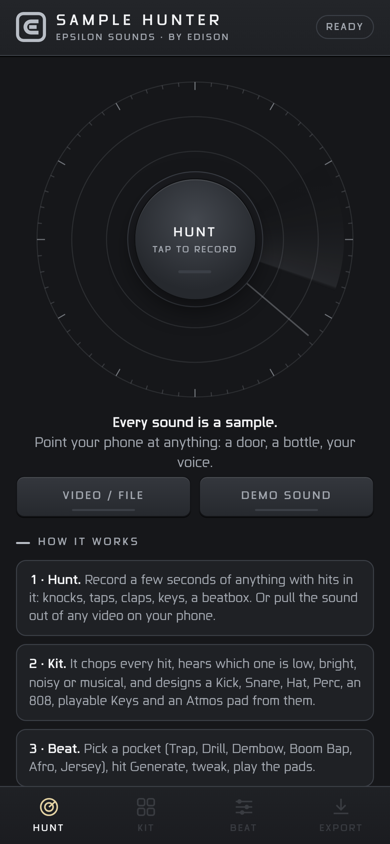
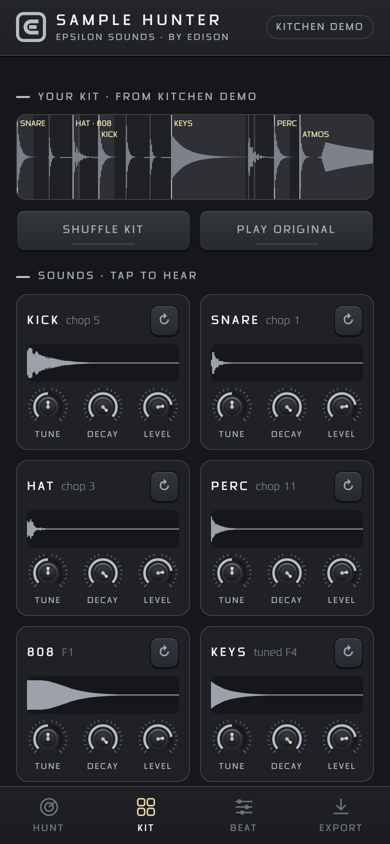
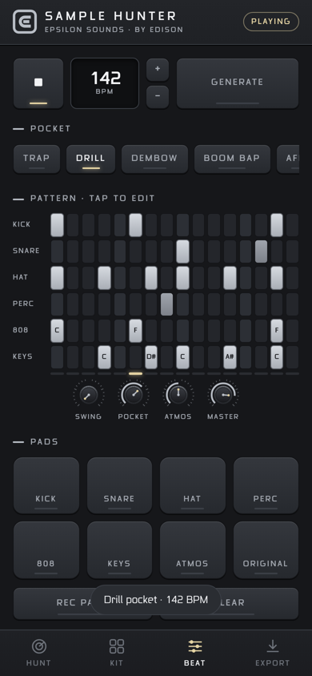
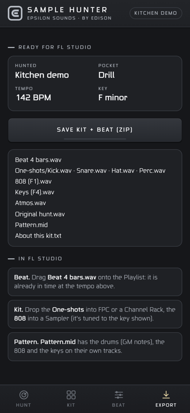

# Sample Hunter

**Every sound is a sample.** Point your phone at anything (a door, a bottle, your keys, your voice) and in a few seconds you have a drum kit, an 808 in the key of your sound, playable keys, an atmosphere pad, and a beat in the pocket you choose. Then take it all to FL Studio in one ZIP.

## Install (no build needed)

**iPhone, no Xcode:** open [SampleHunter.ipa](https://github.com/Epsilonmuz/Sample-Hunter/releases/latest/download/SampleHunter.ipa) on the iPhone and open it with SideStore (one-time setup as in [Finish Line](https://github.com/Epsilonmuz/Finish-Line-#install-on-iphone-without-xcode-free)). Refresh in SideStore every 7 days.

**Or no install at all:** open https://epsilonmuz.github.io/Sample-Hunter/ in Safari, then Share > Add to Home Screen.


By **Epsilon Sounds** · made by Edison.

<p>




</p>

## iPhone app

A native iPhone app lives in [`ios/`](ios/): double-click `ios/SampleHunter.xcodeproj`, choose your Apple ID as the team, plug in your iPhone and press ▶. Step by step: [ios/INSTALL-iPhone.md](ios/INSTALL-iPhone.md). It records with the iPhone microphone, plays with the silent switch on, saves through the share sheet (AirDrop the ZIP to your Mac) and buzzes on the pads. CI builds it for the simulator and for a real iPhone on every push and launches it on an iPhone simulator.

## Open it in the browser

**https://epsilonmuz.github.io/Sample-Hunter/** on your iPhone, in Safari. Then **Share → Add to Home Screen**: it opens full-screen like an app, records with the microphone, and works offline after the first visit. Android: Chrome → *Install app*.

## What it does

1. **Hunt.** Tap HUNT and record up to 30 seconds. Or pull the sound out of any video or voice memo on your phone. Or tap *Demo sound*.
2. **Kit.** Every hit is chopped and listened to: which one is low, bright, noisy, musical. From them it designs a **Kick, Snare, Hat, Perc**, an **808** tuned to the key of your sound, **Keys** from your most musical chop (tuned, playable), and a reversed **Atmos** pad. Each has Tune, Decay and Level; ↻ swaps in another chop; *Shuffle kit* rolls a new kit from the same hunt.
3. **Beat.** Six pockets with the microtiming from Epsilon Bounce: **Trap, Drill, Dembow, Boom Bap, Afro, Jersey**. *Generate* writes a pattern; tap cells to edit (808 and keys cycle through notes of the key); Swing, Pocket amount, Atmos and Master knobs; eight pads to play live, *Rec pads* writes what you play into the pattern.
4. **Export.** One ZIP for FL Studio:
   - `Beat 4 bars.wav`: loops seamlessly and lands exactly on FL's grid at the tempo shown
   - `One-shots/` Kick, Snare, Hat, Perc
   - `808 (note).wav` and `Keys (note).wav`, root note in the name, ready for a Sampler
   - `Atmos.wav`, `Original hunt.wav`
   - `Pattern.mid`: drums (GM: 36 kick, 38 snare, 42 hat, 39 perc), 808 and keys on their own tracks

Everything runs on the phone: no account, no upload, no cloud AI. It works with the silent switch on.

## Under the hood

- `src/engine.js`: the producer's ear, no DOM: onset detection (log-energy + high-frequency flux, adaptive threshold), per-chop features (spectral centroid, low-end ratio, flatness, decay, autocorrelation pitch with octave-error protection), role assignment, the key, pockets and patterns, and 24-bit WAV / type-1 MIDI / ZIP writers.
- `src/app.html`: UI and audio. Each kit voice is designed offline (OfflineAudioContext) from its chop; playback uses a look-ahead scheduler on the audio clock; the export renders the same schedule offline, wraps the tail so the loop is seamless, and removes the browser compressor's look-ahead (6 ms in Chrome) so the WAV is sample-accurate.
- `build.py` inlines everything into one `docs/index.html` (also published as a Claude page) plus the icons, web-app manifest and offline worker.
- `tests/test.mjs`: headless Chrome at iPhone size: demo hunt (12 sounds, all 7 voices, key F from the bottle), roles sane, pocket tempo, playback, export timing (every hit within 0.25 ms of the grid), ZIP export, file import, live mic through a fake device, no page errors. Runs on every push before Pages publishes.

## Build

```
python3 build.py                      # -> docs/
npm install --no-save playwright && npx playwright install chromium
node tests/test.mjs                   # screenshots in shots/
```
